<p align="center">
  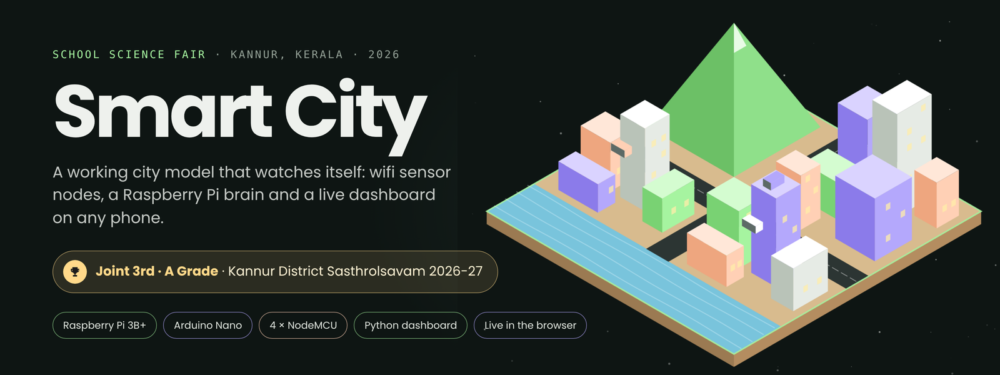
</p>

<p align="center">
  <a href="#-result"></a>
  
  
  
  <a href="LICENSE"></a>
</p>

<p align="center">
  <a href="#features">Features</a> ·
  <a href="#screens">Screens</a> ·
  <a href="#how-it-works">How it works</a> ·
  <a href="#quick-start">Quick start</a> ·
  <a href="#documentation">Docs</a> ·
  <a href="#the-story-film">Story film</a>
</p>

# Smart City

A working model of a smart city, built for a school science fair. A Raspberry Pi
collects live data from wifi sensor nodes around the model and shows everything on one
operations dashboard that opens in any browser on the same network: weather, air quality,
soil, street lighting, a traffic signal and vehicle counter, a disaster alarm on the
mountain, a tsunami monitor, an NFC parking gate, a small status display and one
**City Risk** score for the whole city.

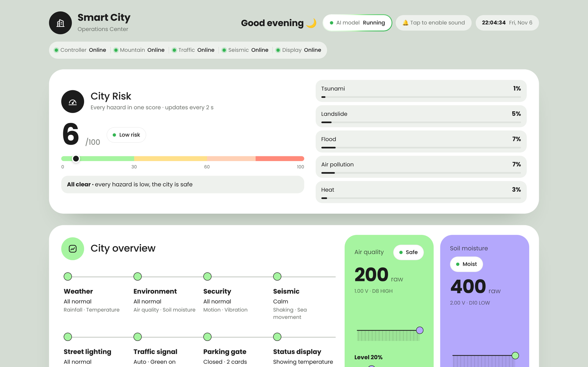

## 🏆 Result

**Joint 3rd place, A Grade (6 points)** in *Science Fair HSS/VHSS · Working Model* at the
**Kannur District School Sasthrolsavam 2026-27**, Thaliparamba (31 Oct – 3 Nov 2026),
out of 126 teams. Presented by **Santhichith A** and **Rishdev P V**, Ranijai HS Nirmalagiri.

## Features

**Safety**
- **Tsunami monitor**: the ultrasonic sees the water move 2 cm or more **and** the shake level is 50+, together for 0.5 s → *Tsunami alert*, siren, live seismograph
- **Mountain disaster alarm**: PIR motion **and** vibration together for 0.5 s → red banner, siren and a flashing *DANGER* screen on the OLED
- **City Risk score**: one 0-100 number (Low / Medium / High) from tsunami, landslide, flood, air pollution and heat, with the main reason
- **City AI**: weighted risk predictions (landslide, air pollution, rain next hour, traffic next hour) from the live sensors every 2 s

**Mobility**
- **Smart traffic signal**: manual control from the dashboard, or auto mode where the ultrasonic turns the light yellow (< 20 cm) and red (< 10 cm)
- **Traffic density**: every vehicle the traffic ultrasonic sees is logged; vehicles a minute, road density %, a 30-minute chart and a vehicle log (topped up with clearly labelled sample traffic)
- **NFC parking gate**: a saved card on the RC522 reader opens a servo barrier for 2 s; unknown cards stay shut and can be allowed from the dashboard; works even with the Pi off

**Environment**
- **Rain, gas (air quality) and soil moisture** from an Arduino Nano on the Pi's USB
- **Live temperature** from the internet (Open-Meteo, Thaliparamba, Kannur)
- **Street lighting**: ambient light level from an LDR
- **Status display**: 0.96" OLED that rotates weather, temperature and air quality, with a live copy on the dashboard

**Dashboard**
- Pastel, phone-friendly page served by the Pi on port `8765`, updated live (Server-Sent Events)
- **Stable on a phone hotspot**: a node only shows *offline* after 10 s of real silence; the page reconnects by itself
- **Raspberry Pi card**: CPU temperature, power, load, memory, wifi, up time, SD card, *Restart dashboard*
- **History**: 24-hour charts and an event log (starts with labelled sample data)
- Pop-up notifications, alarm sound, greeting by time of day
- **Zero-configuration networking**: every node finds the Pi by itself, no IP addresses typed anywhere
- **Health check**: one command on the Pi checks everything and prints the fix for each problem

## Screens

| City Risk | Tsunami alert |
|---|---|
| 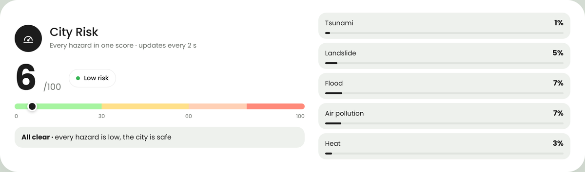 | 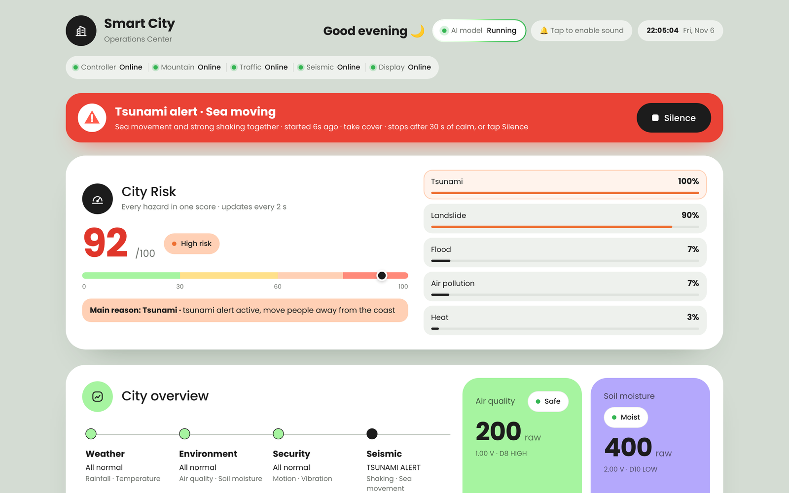 |

| Seismic monitor during a tsunami | Traffic density |
|---|---|
| 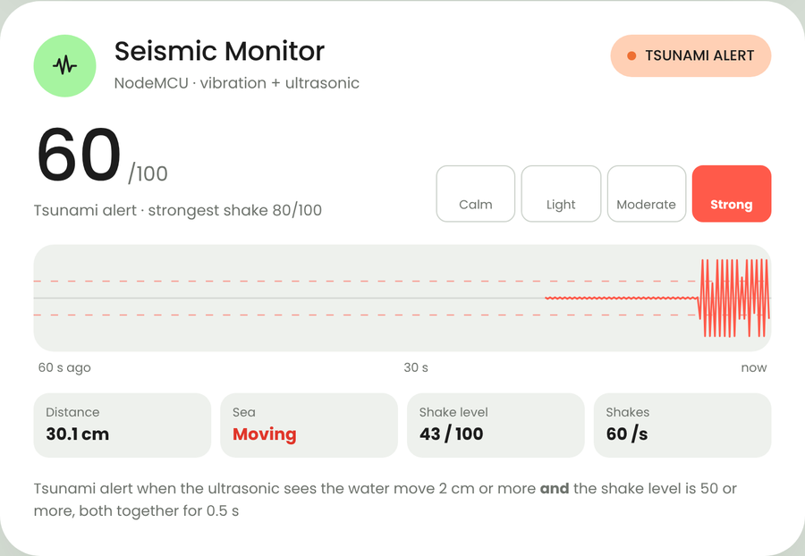 | 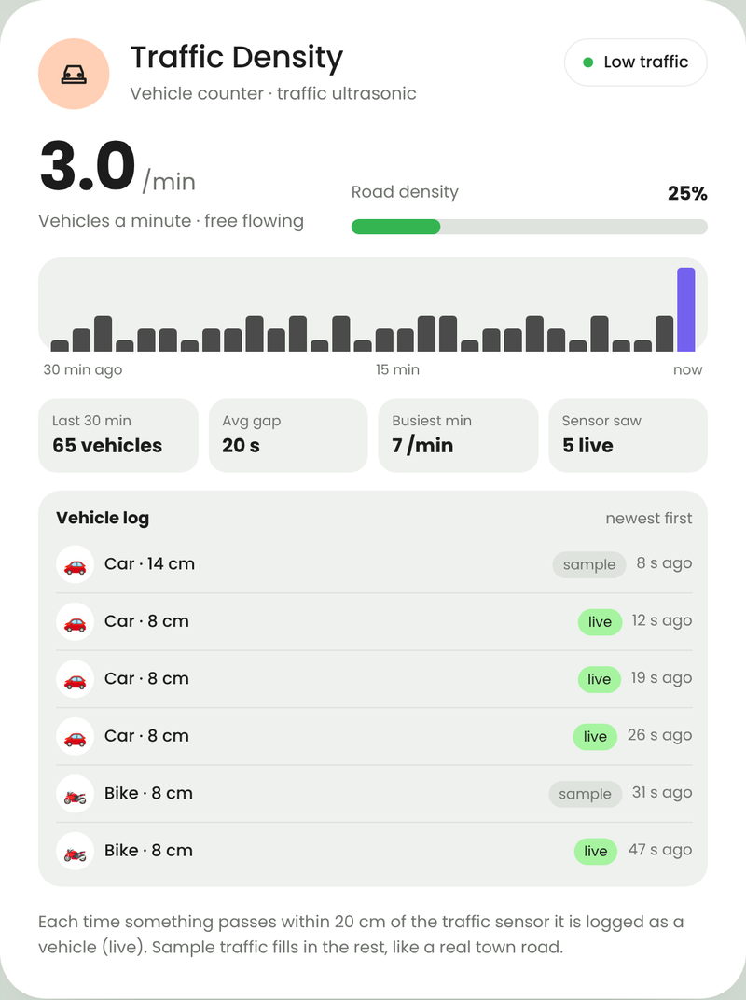 |

| Parking gate | Raspberry Pi |
|---|---|
| 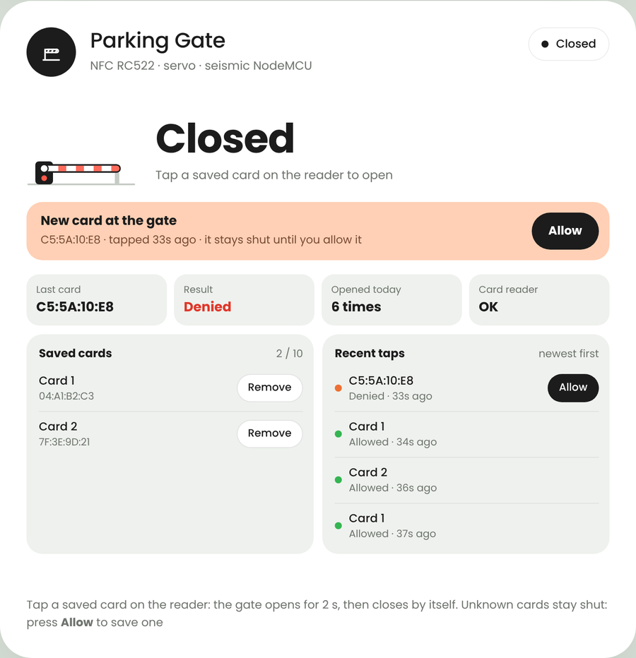 | 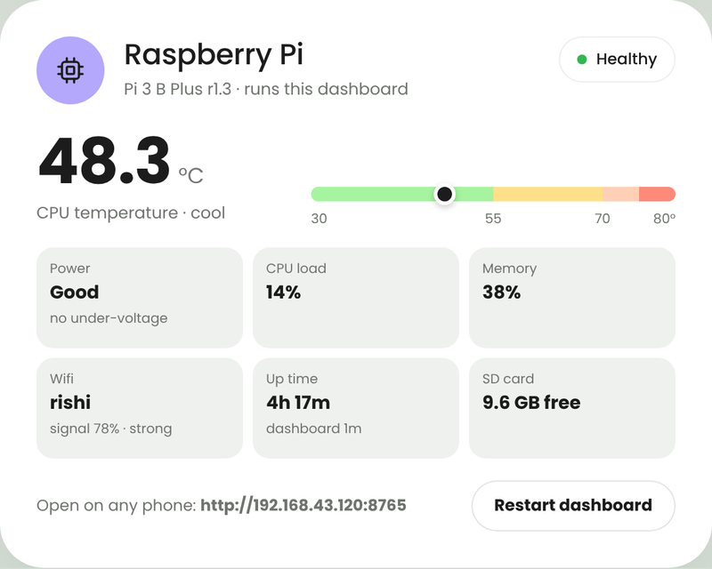 |

| City AI | History |
|---|---|
| 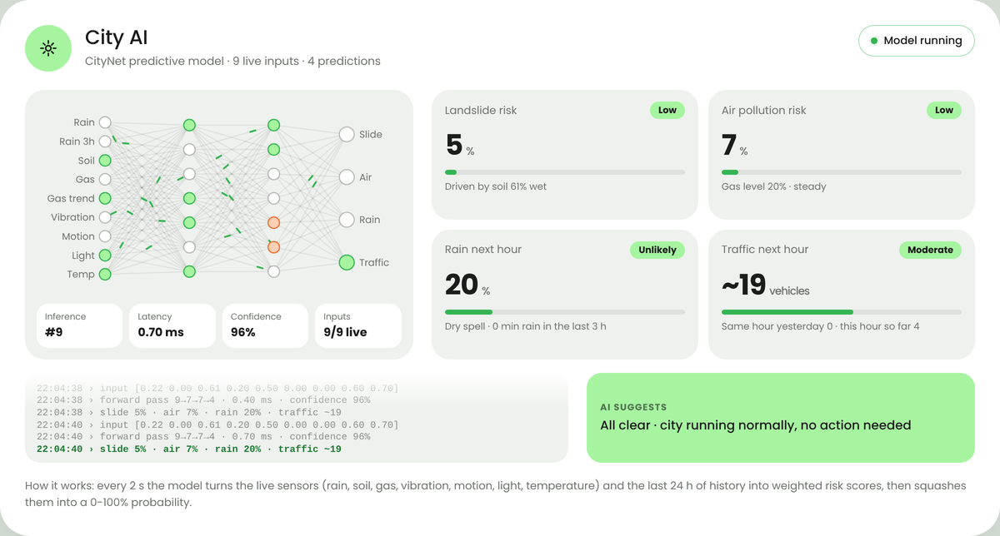 | 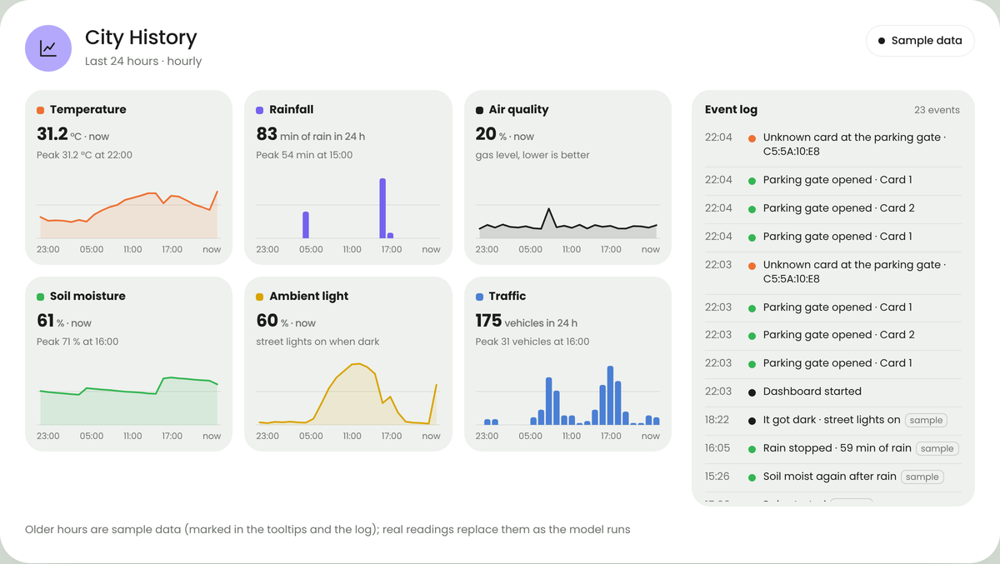 |

| On a phone | OLED screens |
|---|---|
| 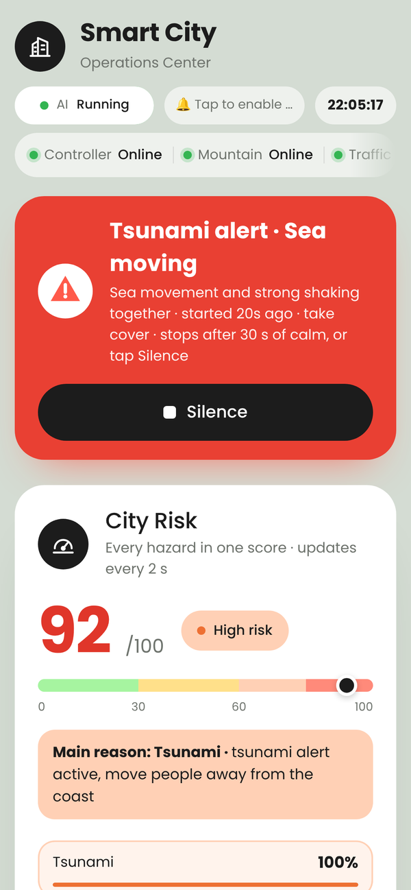 | 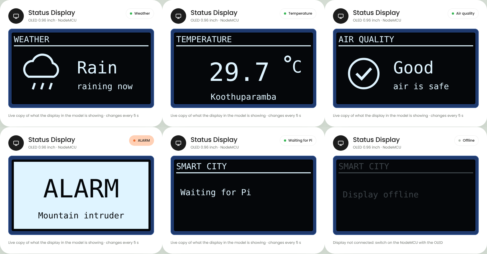 |

The whole page in one picture: [docs/images/dashboard_page.png](docs/images/dashboard_page.png).

## How it works

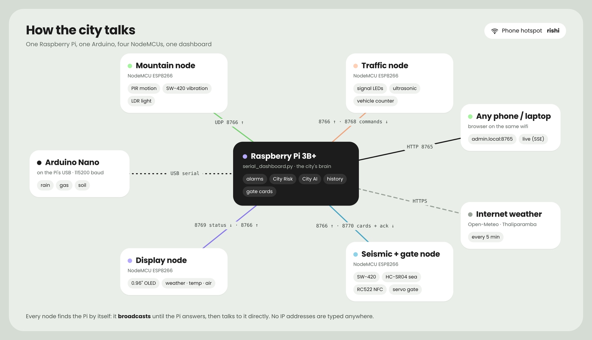

Every wifi node sends small JSON messages to the Pi on UDP port `8766`; the Pi tells them
apart by the keys in the message and answers on its own port per node. Nodes broadcast until
the Pi answers, then talk to it directly. Details: [docs/protocol.md](docs/protocol.md).

## Hardware at a glance

| Node | Board | Parts | Talks to the Pi by |
|---|---|---|---|
| Main controller | Arduino Nano | Rain sensor, MQ gas sensor, soil moisture sensor | USB serial |
| Mountain | NodeMCU ESP8266 | PIR motion, SW-420 vibration, LDR | wifi |
| Traffic | NodeMCU ESP8266 | Red/yellow/green light module, HC-SR04 | wifi |
| Status display | NodeMCU ESP8266 | 0.96" SSD1306 OLED (I2C) | wifi |
| Seismic + parking gate | NodeMCU ESP8266 | SW-420 vibration, HC-SR04, RC522 NFC reader, SG90 servo | wifi |
| Hub | Raspberry Pi 3B+ | runs `serial_dashboard.py` | — |

Full wiring and pin tables for every node: [docs/hardware.md](docs/hardware.md).

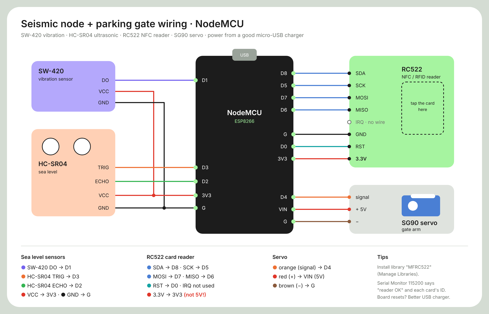

## Quick start

1. **Flash the boards** with the Arduino IDE (sketches in `firmware/`). Set the wifi
   name and password at the top of each wifi sketch. Board settings and wiring:
   [docs/hardware.md](docs/hardware.md).
2. **Set up the Raspberry Pi** (from your computer):
   ```bash
   ssh -t admin@admin.local "sudo apt install -y python3-serial && mkdir -p ~/smartcity"
   scp raspberry-pi/serial_dashboard.py raspberry-pi/alarm.mp3 admin@admin.local:~/smartcity/
   ssh admin@admin.local "python3 ~/smartcity/serial_dashboard.py /dev/ttyUSB0"
   ```
3. **Open the dashboard** at `http://admin.local:8765` (or the address it prints)
   from any phone or laptop on the same wifi.
4. **Check everything** with the health check:
   ```bash
   scp raspberry-pi/check_smartcity.sh admin@admin.local:~/
   ssh -t admin@admin.local "sudo bash check_smartcity.sh"
   ```

To start the dashboard automatically at boot, follow [docs/raspberry-pi-setup.md](docs/raspberry-pi-setup.md).

## Repository layout

```
smartcity/
├── raspberry-pi/
│   ├── serial_dashboard.py          # the whole Pi side: sensor bridge + web dashboard
│   ├── alarm.mp3                    # alarm sound played by the dashboard
│   ├── check_smartcity.sh           # health check: everything working, nothing duplicated
│   ├── pi_optimize.sh               # optional Pi tune-up (auto-restart, watchdog, faster boot)
│   └── smartcity-dashboard.service  # systemd service to start the dashboard at boot
├── firmware/
│   ├── nano_sensor_node/            # Arduino Nano: rain, gas, soil (USB to the Pi)
│   ├── esp8266_mountain_node/       # NodeMCU ESP8266: PIR motion, vibration, LDR
│   ├── esp8266_traffic_node/        # NodeMCU ESP8266: traffic light + HC-SR04
│   ├── esp8266_oled_node/           # NodeMCU ESP8266: 0.96" OLED status display
│   └── esp8266_seismic_node/        # NodeMCU ESP8266: vibration + HC-SR04, RC522 NFC + servo gate
├── docs/                            # guides, screenshots and the story film
└── CHANGELOG.md                     # what changed, day by day
```

## Documentation

| Guide | What's inside |
|---|---|
| [Hardware & wiring](docs/hardware.md) | Every node: parts, pins, board settings, tips |
| [Raspberry Pi setup](docs/raspberry-pi-setup.md) | Install, run at boot, update, tune-up, health check, settings |
| [Dashboard](docs/dashboard.md) | Every card, alarm rules, City Risk, traffic density, the City AI, history |
| [Network protocol](docs/protocol.md) | UDP ports and message formats between the nodes and the Pi |
| [Troubleshooting](docs/troubleshooting.md) | Problems we hit while building it, and the fixes |
| [Changelog](CHANGELOG.md) | Every change from the first commit to the fair |

## The story film

[`docs/smart-city-film.html`](docs/smart-city-film.html) is a 1:46 animated film (in Manglish)
of the whole journey, from the first idea to **joint 3rd, A grade** at the district fair.
Download the file and open it in any browser; turn the sound on and press **Play cheyyu**.

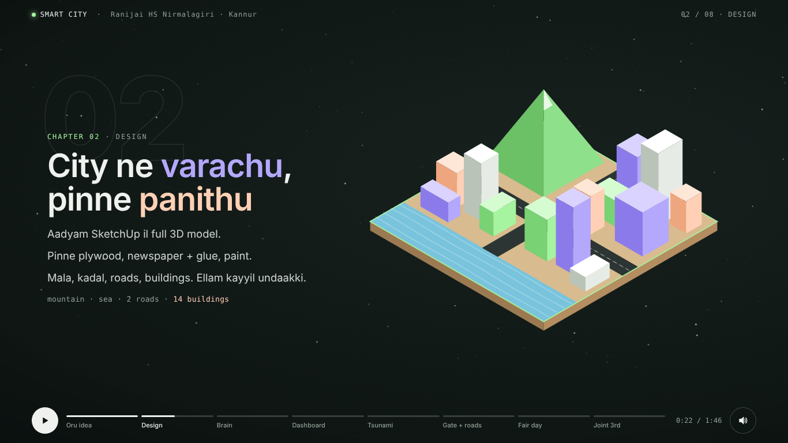

## Contributors

| | Role |
|---|---|
| **[@dhyandevp](https://github.com/dhyandevp)** | Main contributor |
| [@santhichith1-cmyk](https://github.com/santhichith1-cmyk) | Contributor |

## License

[MIT](LICENSE) © 2026 dhyandevp
