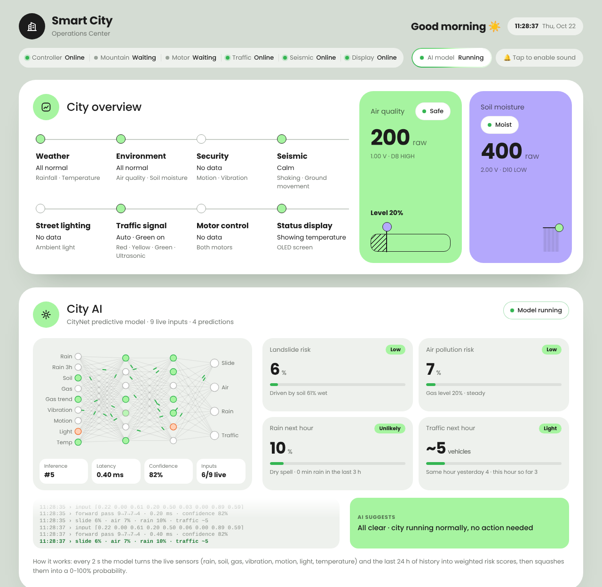
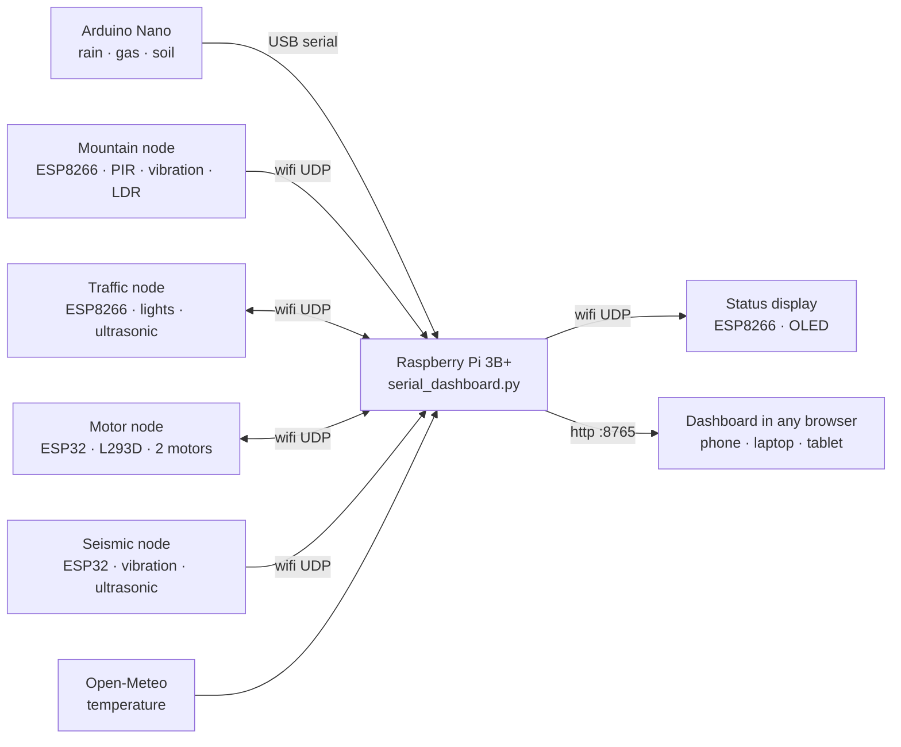
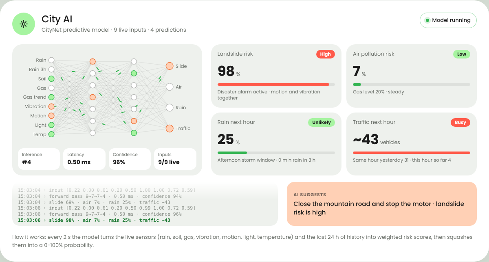
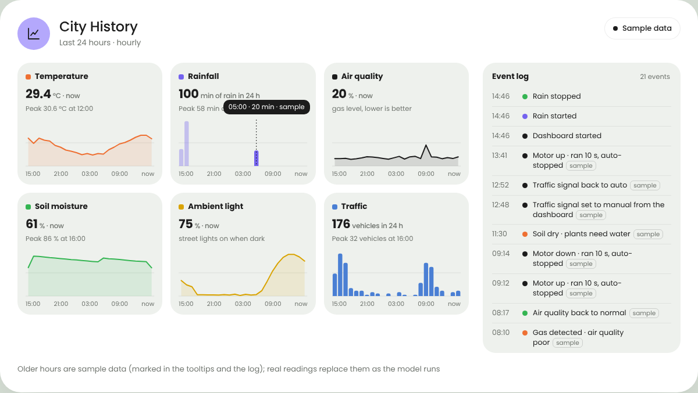
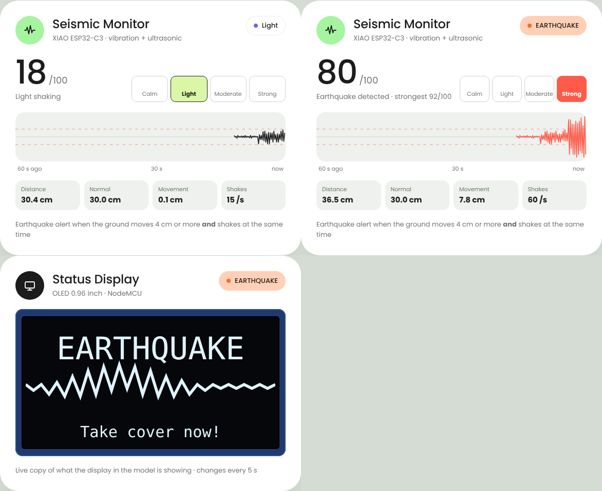
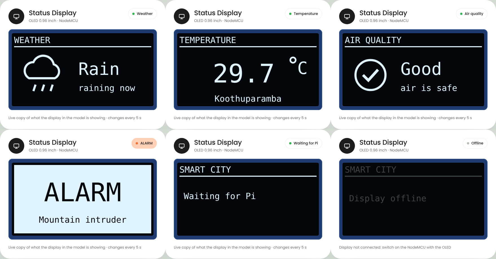

# Smart City 🏙️

A working model of a smart city, built for a school science fair. A Raspberry Pi
collects live data from wifi sensor nodes around the model and shows everything
on one operations dashboard that opens in any browser on the same network:
weather, air quality, soil, street lighting, a traffic signal, motors, a disaster
alarm on the mountain, an earthquake monitor and a small status display.



## Features

- **Live operations dashboard**: pastel, phone-friendly web page served by the Pi (port `8765`), updated instantly over Server-Sent Events
- **City overview**: one glance at weather, environment, security, seismic, lighting, traffic, motors and the display
- **Environment**: rain, gas (air quality) and soil moisture from an Arduino Nano; live temperature from the internet (Open-Meteo, Koothuparamba)
- **Mountain disaster alarm**: PIR motion + vibration on together for 0.5 s → red banner, siren sound and a flashing *DANGER* screen
- **Earthquake monitor**: vibration + ultrasonic ground movement (4 cm or more) together for 0.5 s → *Earthquake detected* alert with a live seismograph
- **Smart traffic signal**: manual control from the dashboard, or auto mode where an ultrasonic sensor turns the light yellow (< 20 cm) and red (< 10 cm)
- **Motor control**: Up / Stop / Down for two motors with automatic safety stop
- **Street lighting**: ambient light level from an LDR
- **Status display**: 0.96" OLED that rotates weather, temperature and air quality every 5 s, with a live copy on the dashboard
- **City AI card**: weighted risk scores (landslide, air pollution, rain, traffic) calculated from the live sensors every 2 s
- **History**: 24-hour charts and an event log (starts with clearly labelled sample data until the model has run for a day)
- **Pop-up notifications and alarm sound**, greeting by time of day, smooth animations
- **Zero configuration networking**: every node announces itself by UDP broadcast, so no IP addresses are ever typed in

## How it works



All wifi nodes send small JSON messages to the Pi on UDP port `8766`; the Pi tells
them apart by the first key in the message. See [docs/protocol.md](docs/protocol.md).

## Repository layout

```
smartcity/
├── raspberry-pi/
│   ├── serial_dashboard.py          # the whole Pi side: sensor bridge + web dashboard
│   ├── alarm.mp3                    # alarm sound played by the dashboard
│   ├── pi_optimize.sh               # optional Pi tune-up (auto-restart, watchdog, faster boot)
│   └── smartcity-dashboard.service  # systemd service to start the dashboard at boot
├── firmware/
│   ├── nano_sensor_node/            # Arduino Nano: rain, gas, soil (USB to the Pi)
│   ├── esp8266_mountain_node/       # NodeMCU ESP8266: PIR motion, vibration, LDR
│   ├── esp8266_traffic_node/        # NodeMCU ESP8266: traffic light + HC-SR04
│   ├── esp8266_oled_node/           # NodeMCU ESP8266: 0.96" OLED status display
│   ├── esp32_motor_node/            # ESP32: 2 motors with an L293D driver
│   └── esp32_seismic_node/          # ESP32 (NodeMCU ESP-32S): vibration + HC-SR04
└── docs/                            # guides and screenshots
```

## Hardware at a glance

| Node | Board | Parts | Talks to the Pi by |
|---|---|---|---|
| Main controller | Arduino Nano | Rain sensor, MQ gas sensor, soil moisture sensor | USB serial |
| Mountain | NodeMCU ESP8266 | PIR motion, SW-420 vibration, LDR | wifi |
| Traffic | NodeMCU ESP8266 | Red/yellow/green light module, HC-SR04 | wifi |
| Status display | NodeMCU ESP8266 | 0.96" SSD1306 OLED (I2C) | wifi |
| Motors | ESP32 DevKit | L293D driver board, 2 DC motors | wifi |
| Seismic | NodeMCU ESP-32S v1.1 | SW-420 vibration, HC-SR04 | wifi |
| Hub | Raspberry Pi 3B+ | — | — |

Full wiring for every node: [docs/hardware.md](docs/hardware.md).

## Quick start

1. **Flash the boards** with the Arduino IDE (sketches in `firmware/`). Set the wifi
   name and password at the top of each wifi sketch. Board settings and wiring are in
   [docs/hardware.md](docs/hardware.md).
2. **Set up the Raspberry Pi**:
   ```bash
   sudo apt install -y python3-serial
   mkdir -p ~/smartcity && cp raspberry-pi/* ~/smartcity/
   python3 ~/smartcity/serial_dashboard.py /dev/ttyUSB0
   ```
3. **Open the dashboard** at `http://<pi-address>:8765` (for example `http://admin.local:8765`)
   from any phone or laptop on the same wifi.

To start it automatically at boot, follow [docs/raspberry-pi-setup.md](docs/raspberry-pi-setup.md).

## Documentation

| Guide | What's inside |
|---|---|
| [Hardware & wiring](docs/hardware.md) | Every node: parts, pins, board settings, tips |
| [Raspberry Pi setup](docs/raspberry-pi-setup.md) | Install, run at boot, update, optional tune-up |
| [Dashboard](docs/dashboard.md) | Every card, alarm rules, the City AI, history |
| [Network protocol](docs/protocol.md) | UDP ports and message formats between the nodes and the Pi |
| [Troubleshooting](docs/troubleshooting.md) | Problems we hit while building it, and the fixes |

## Screenshots

| City AI | History |
|---|---|
|  |  |

| Seismic monitor + OLED preview | OLED screens |
|---|---|
|  |  |

## Contributors

| | Role |
|---|---|
| **[@dhyandevp](https://github.com/dhyandevp)** | Main contributor |
| [@santhichith1-cmyk](https://github.com/santhichith1-cmyk) | Contributor |

## License

[MIT](LICENSE) © 2026 dhyandevp
