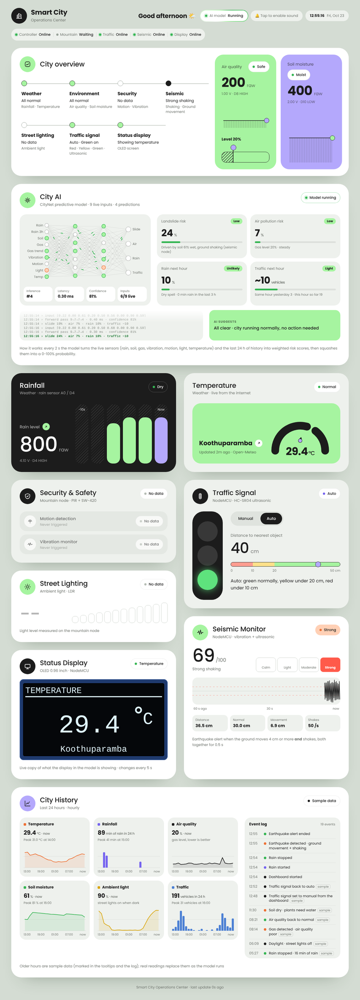
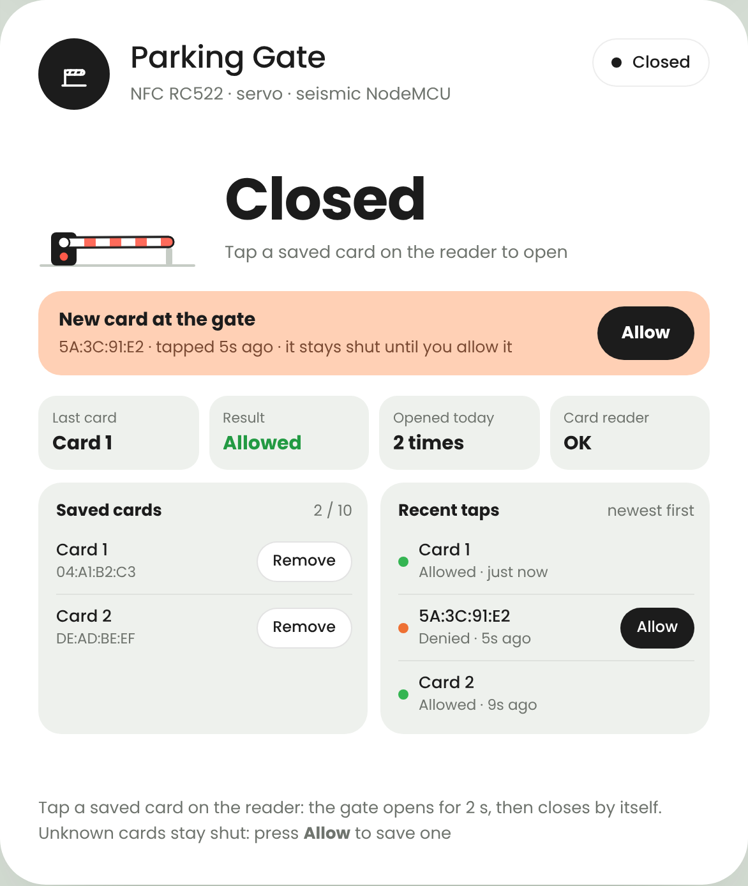
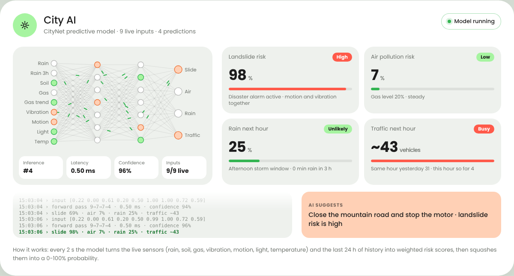
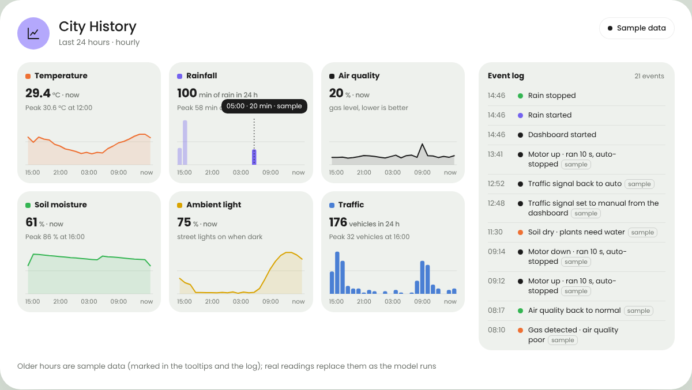

# Dashboard

Open `http://<pi-address>:8765` on any phone, tablet or laptop on the same wifi.
The page works in portrait and landscape and updates instantly when a sensor changes.

## Top bar

- Greeting for the time of day, and a live clock
- Status of every node: **Controller, Mountain, Traffic, Seismic, Display**
  (green = online, orange = lost, grey = waiting)
- **AI model** chip (jumps to the City AI card) and the **Sound** button. Browsers only
  play sound after one tap on the page, so tap once when the dashboard opens.

## Cards

| Card | Shows |
|---|---|
| City overview | 8 areas at a glance, plus the air quality and soil moisture tiles |
| City AI | 4 live risk predictions (see below) |
| Rainfall | Rain sensor level and recent bars |
| Temperature | Live temperature for Koothuparamba (Open-Meteo, every 5 minutes) |
| Security & Safety | Mountain motion and vibration, when each last triggered |
| Street Lighting | Ambient light level from the LDR |
| Status Display | A live copy of what the OLED in the model is showing |
| Traffic Signal | Manual / Auto, tap a lamp to switch it, live ultrasonic distance |
| Seismic Monitor | Live 60 s seismograph, Calm / Light / Moderate / Strong, distance, sea movement and shake level |
| Raspberry Pi | CPU temperature, power (under-voltage), CPU load, memory, wifi name + signal, up time, SD card space, the address to open, and a **Restart dashboard** button (tap twice) |
| Parking Gate | NFC card reader + servo barrier: Open / Closed, last card (Allowed / Denied), opens today, saved cards and recent taps |
| City History | 24 h charts and an event log |

## Alarms

| Alarm | Fires when | Stops |
|---|---|---|
| **Potential disaster · Mountain** | Motion **and** vibration on together for 0.5 s | 30 s of quiet, or tap **Silence** |
| **Tsunami alert** | Water moving 2 cm or more (ultrasonic) **and** shake level 50+, together for 0.5 s | 30 s of calm, or tap **Silence** |

Both show a red banner, play `alarm.mp3`, flash the matching card and switch the OLED to
its warning screen. After **Silence** the alarm re-arms once the sensors calm down.

Pop-up notifications also appear for rain starting/stopping, poor air quality, dry soil,
high temperature, nodes going offline and every card tapped on the parking gate.

## Parking gate

- Tap a **saved** card on the RC522 reader: the barrier opens for **2 s**, then closes by itself.
- Tap an **unknown** card: the gate stays shut and a peach **New card at the gate** box
  appears. Press **Allow** to save it as *Card 1*, *Card 2*… (up to 10). Unknown cards in
  *Recent taps* have their own **Allow** button too.
- **Remove** a saved card with two taps (*Remove* → *Sure?*).
- Saved cards are stored on the Pi in `raspberry-pi/gate_cards.json` and copied to the node,
  which keeps them in flash, so the gate keeps working if the Pi is switched off.
- Every opening, unknown card, save and removal also goes into the City History event log.

## City AI

Every 2 seconds the dashboard turns the live sensor readings (rain, soil, gas and its
trend, vibration, motion, light, temperature, seismic shaking) and the last 24 hours of
history into **weighted risk scores**, then squashes each score into a 0-100 % chance:

- **Landslide risk**: wet rain sensor, recent rain, wet soil, shaking on the mountain or
  the seismic node, an active alarm
- **Air pollution risk**: gas level, rising gas, gas sensor alarm
- **Rain next hour**: raining now, recent rain, afternoon storm hours, heat
- **Traffic next hour**: the same hour yesterday blended with this hour so far

It also suggests an action (for example *Close the mountain road*).
It is a rule-based scoring model, not a trained neural network: the network drawing
is an illustration of the inputs and outputs.

## History

Hourly charts for temperature, rainfall, air quality, soil moisture, ambient light and
traffic, plus an event log. Because the model is not running all day, the history starts
filled with **sample data**, clearly marked with a *Sample data* tag and a *sample* label
on each sample event. Real readings replace the sample hours as the model runs, and the
tag disappears once 24 real hours exist. History is kept in memory, so it restarts with
the dashboard.
