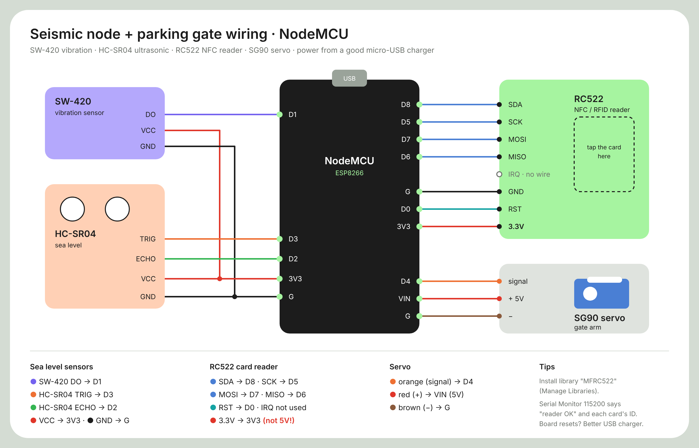

# Hardware & wiring

Every wifi node must join the **same 2.4 GHz wifi** as the Raspberry Pi (we use a phone
hotspot). Put the wifi name and password at the top of each wifi sketch
(`WIFI_SSID` / `WIFI_PASS`) before uploading.

**Arduino IDE board packages**

| Boards | Boards Manager package |
|---|---|
| Arduino Nano | built in (*Arduino AVR Boards*) |
| NodeMCU ESP8266 | *esp8266 by ESP8266 Community* (board: **NodeMCU 1.0 (ESP-12E Module)**) |

No extra libraries are needed for any sketch.

> **Ground rule:** every module's GND goes to the board's GND. ESP8266 pins are
> **3.3 V only**: never feed 5 V into an input pin.

---

## 1. Main controller: Arduino Nano (`firmware/nano_sensor_node`)

Connected to the Pi by USB (shows up as `/dev/ttyUSB0`, 115200 baud). Prints a block of
readings 4 times a second; the Pi reads it directly.

| Sensor | Analog out | Digital out | Power |
|---|---|---|---|
| Rain sensor | A0 | D4 | 5V, GND |
| Gas sensor (MQ series) | A1 | D8 | 5V, GND |
| Soil moisture sensor | A3 | D10 | 5V, GND |

Gas is judged from the **analog level** (a higher reading means more gas): **50 % or more =
Gas detected**, back to Safe below 45 % (`GAS_ALERT_PCT` / `GAS_CLEAR_PCT` in
`serial_dashboard.py`). The D8 pin is only shown for reference.

Keep D0 / D1 free (USB serial). Temperature is **not** measured here: the Pi gets the
live temperature from the internet.

## 2. Mountain node: NodeMCU ESP8266 (`firmware/esp8266_mountain_node`)

| Part | Pin | Power |
|---|---|---|
| PIR motion sensor OUT | D5 | VIN (5V), GND |
| SW-420 vibration DO | D6 | 3V3, GND |
| LDR module AO | A0 | 3V3, GND |

Bare LDR instead of a module: `3V3 → LDR → A0 → 10 kΩ → GND`.
Calibrate the light level with `LIGHT_DARK_RAW`, `LIGHT_BRIGHT_RAW` and `LIGHT_INVERT`.

**Alarm:** motion **and** vibration on together for 0.5 s → *Potential disaster*.

## 3. Traffic node: NodeMCU ESP8266 (`firmware/esp8266_traffic_node`)

| Part | Pin |
|---|---|
| Traffic light module G | D1 |
| Traffic light module Y | D2 |
| Traffic light module R | **D7** (not D3: D3 must be HIGH at boot) |
| Traffic light module GND | G |
| HC-SR04 Trig | D5 |
| HC-SR04 Echo | D6 |
| HC-SR04 VCC / GND | 3V3 (worked in our build) or VIN 5V with a divider, GND |

If the HC-SR04 runs on 5 V, its Echo pin outputs 5 V: use `Echo → 1 kΩ → D6` and
`D6 → 2 kΩ → GND`.

**Auto mode:** nothing near → green, closer than 20 cm → yellow, closer than 10 cm → red.

## 4. Status display: NodeMCU ESP8266 + 0.96" OLED (`firmware/esp8266_oled_node`)

| OLED pin | NodeMCU |
|---|---|
| VCC | 3V3 |
| GND | G |
| SCL | D1 |
| SDA | D2 |

I2C address `0x3C`. Library-free driver, so nothing to install. Screens rotate every
5 s: **Weather → Temperature → Air quality**. Alarms take over the screen:

| Disaster alarm | Earthquake |
|---|---|
|  |  |

## 5. Seismic node + parking gate: NodeMCU ESP8266 (`firmware/esp8266_seismic_node`)

One NodeMCU runs two jobs: the **tsunami alert** (vibration + ultrasonic) and the
**parking gate** (RC522 NFC reader + servo). Install the **MFRC522** library
(*Sketch → Include Library → Manage Libraries*); Servo, SPI and EEPROM come with the
ESP8266 board package.

| Part | Pin |
|---|---|
| SW-420 vibration DO | D1 |
| HC-SR04 Trig | D3 |
| HC-SR04 Echo | D2 |
| SW-420 + HC-SR04 VCC / GND | 3V3 / G |
| RC522 SDA | D8 |
| RC522 SCK | D5 |
| RC522 MOSI | D7 |
| RC522 MISO | D6 |
| RC522 RST | D0 |
| RC522 IRQ | not connected |
| RC522 3.3V / GND | 3V3 (**not 5V**) / G |
| Servo signal (orange) | D4 |
| Servo + (red) / − (brown) | VIN (5V) / G |

The RC522 talks over SPI, which needs D5, D6 and D7, so the vibration sensor and the
ultrasonic moved to D1, D2 and D3. If the servo makes the board reset, use a better USB
charger or give the servo its own 5V supply (join the grounds).

**Parking gate:** a **saved** card opens the gate (servo to 90°) for 2 s, then it closes by
itself. An unknown card leaves it shut and appears on the dashboard with an **Allow**
button. The saved cards live on the Pi (`raspberry-pi/gate_cards.json`), are sent to the
node every 2 s and are kept in the node's flash, so saved cards still open the gate when
the Pi is off. Angles and timing: `GATE_CLOSED_DEG`, `GATE_OPEN_DEG`, `GATE_OPEN_MS` in the
sketch (swap the two angles if the arm moves the wrong way).

Point the ultrasonic at something flat 10-100 cm away that moves when the "ground"
shakes. The node learns the normal distance by itself. The Serial Monitor (115200)
prints a health line every second, for example
`ultrasonic OK: 30.0 cm (normal 30.0, 25/25 pings) | vibration 0 flips/s | calm, 1 reports/s | gate closed, reader OK, 2 card(s) | wifi ok | Pi heard us OK (192.168.43.120)`,
and a line such as `Card 04A1B2C3 -> ALLOWED, opening the gate` for every card.

If it says **NO ECHO** on 3.3 V, power the HC-SR04 from VIN (5V) and use the
1 kΩ + 2 kΩ divider on Echo (`Echo → 1 kΩ → D2`, `D2 → 2 kΩ → G`).

**Tsunami alert:** water 4 cm or closer to the ultrasonic sensor (sea level high) **and** a shake level of 50/100 or more, together for 0.5 s (`SEA_HIGH_CM`, `QUAKE_SHAKE_MIN` in `serial_dashboard.py`). The HC-SR04 cannot measure closer than about 2 cm.

The node reports once a second when calm and 5 times a second while active, sends
instantly when shaking starts, reads the ultrasonic with interrupts (no waiting),
reconnects wifi by itself and relies on the ESP8266's built-in watchdog.
It broadcasts until the Pi answers, then sends straight to the Pi; the Pi answers every
2 s and the health line ends with **`Pi heard us OK (ip)`**. If it says
**`Pi NOT answering`**, check the new dashboard is running on the Pi and both are on the
same wifi; you can also type the Pi's IP into `PI_IP_FIXED`.

## 6. Raspberry Pi 3B+

Runs `raspberry-pi/serial_dashboard.py`. Plug the Arduino Nano into any USB port.
See [raspberry-pi-setup.md](raspberry-pi-setup.md).
